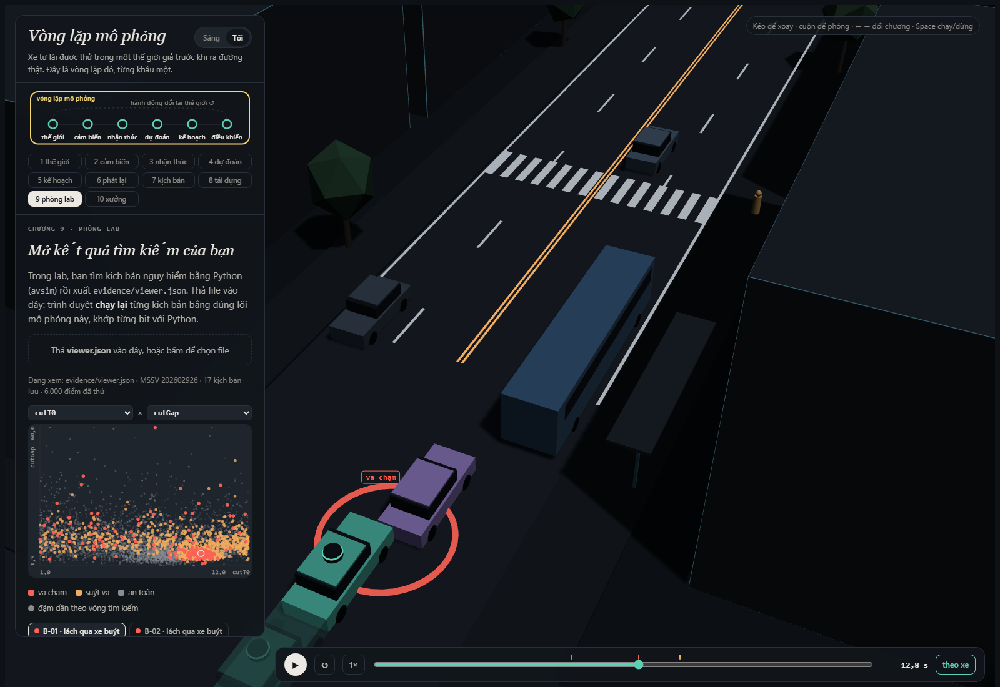
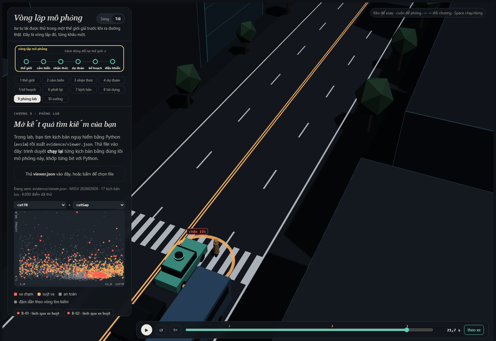
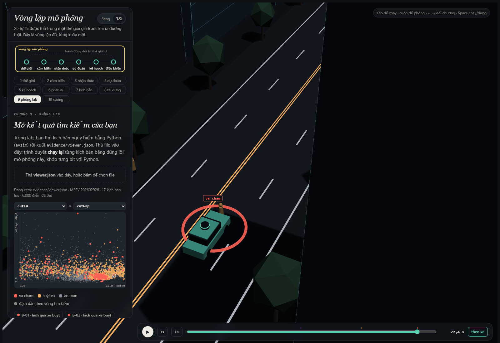

MSSV: 202602926

# Lab 11 · Scenario Forge — báo cáo

Họ tên: Nguyễn Văn Chiến
Địa phương: **Thị trấn Văn Giang**
Biến thể mô phỏng (`meta.json: _run.town`): **B**

Mỗi câu: trả lời ngắn, **trích số từ `evidence/`** (ghi tên file và trường, ví dụ `mc.json: crashes = 4`). Grader chạy lại với MSSV của bạn; số không khớp `evidence/` thì mất điểm phần D (RUBRIC), và câu dựa trên số sai khó được điểm đầy đủ. Không cần văn hay: một bảng nhỏ và hai, ba câu giải thích là đủ.

Thị trấn của bạn (`meta.json: _run.town`): 

## 1. Phát lại log có trung thực không? (bước A)

**Kết quả.** `replay.json` có 400 log, bỏ 0 log do người lái va chạm. Planner trên log phát lại va chạm 118 lần: 108 phía sau, 10 bên hông; thế giới phản ứng có 0, và `crash_in_both = 0`. Phần lớn là `rear` giả vì planner phanh sớm hơn người lái đã tạo log, còn xe sau vẫn chạy theo quỹ đạo cũ và không biết để phanh. Ví dụ `replay_only[0]`, kịch bản 4 bị tông sau khi phát lại, nhưng khi phản ứng thật xe sau duy trì TTC tối thiểu 2,567 s.

Trong `replay.json`: bao nhiêu kịch bản bị bỏ vì người lái gây va chạm, bao nhiêu va chạm khi planner chạy trên log phát lại, bao nhiêu trong thế giới phản ứng, theo từng loại tiếp xúc. Giải thích vì sao phần lớn va chạm của "phát lại" là `rear`, và vì sao đó là va chạm **giả**. Chọn một kịch bản trong `replay_only` và nói chuyện gì đã xảy ra.

## 2. Kịch bản bất khả thi (bước B)

**Kết quả.** `is_feasible` loại: (1) gia tốc ngang cực đại của chuyển làn \((\pi/t)^2 3,5/2 > \mu g\), vì lốp thiếu lực bám ngang; (2) `cutBrake > μg`, vượt lực bám dọc; (3) `pedV > 2,5 m/s`, vượt miền đi bộ của mô hình; (4) `cutV` ngoài `(0,22] m/s`, xe đứng/đi lùi hoặc vượt miền tốc độ lab. `hunt.json` cho số bất khả thi: `crosswalk_block` 13, `cut_in` 10, `rear_ended` 9, `bus_bypass` 1. CEM bị hút về biên cực đoan vì chúng thường có điểm nguy hiểm cao nhất; đếm chúng là va chạm sẽ làm xác suất cao giả tạo.

Liệt kê các luật trong `is_feasible` và căn cứ vật lý của từng luật (ma sát, gia tốc, tốc độ người). Trong `hunt.json`, cuộc săn nào sinh nhiều kịch bản bất khả thi nhất, và vì sao CEM lại bị kéo về phía đó? Điều gì xảy ra với ước lượng nếu bạn **đếm** chúng là va chạm?

## 3. Monte Carlo cho bạn biết gì (bước C1)

**Kết quả.** `mc.json`: 5/3.000, \(\hat p=1,667\times10^{-3}\), Wilson 95% \([7,121\times10^{-4},3,896\times10^{-3}]\). Theo \(n\approx96/p\), cần khoảng **57.600** lượt để sai số xấp xỉ ±20% của p. Cả 5 ca là `bus_bypass`; bốn kiểu còn lại chưa thấy. Không báo 0: `mc.json: per_mode.*.hi` cho cận Wilson trên 95% là **1,279×10⁻³** cho mỗi kiểu chưa thấy.

`mc.json`: k, n, p̂ và khoảng Wilson 95 %. Với p̂ đó, cần bao nhiêu lần chạy để khoảng tin cậy hẹp lại còn ±20 % của p? Có kiểu thất bại nào **chưa hề xuất hiện** trong 3 000 lần chạy không? Con số đúng cần báo cho kiểu đó là gì?

## 4. Importance sampling, ESS và độ suy biến (bước C3)

**Kết quả (`estimate.json: seeds[*].per`):**

| Kiểu | Seed | p | hits | ESS | top_share |
|---|---:|---:|---:|---:|---:|
| bus_bypass | 0 | 1,025e-3 | 45 | 125,94 | 0,205 |
| bus_bypass | 1 | 1,234e-3 | 51 | 135,95 | 0,270 |
| bus_bypass | 2 | 1,694e-3 | 46 | 133,56 | 0,573 |
| cut_in | 0/1/2 | 0 hit; cận 2,5e-2 | 0/0/0 | 115,67/122,73/117,08 | 0 |
| crosswalk_block | 0 | 7,259e-7 | 93 | 127,19 | 0,272 |
| crosswalk_block | 1 | 3,407e-6 | 86 | 116,55 | 0,406 |
| crosswalk_block | 2 | 3,057e-7 | 87 | 103,17 | 0,140 |
| rear_ended | 0/1/2 | 0 hit; cận 2,5e-2 | 0/0/0 | 132,82/123,04/105,05 | 0 |

Tổng ba seed là 1,025e-3, 1,237e-3, 1,695e-3, cùng bậc MC 1,667e-3; `crosswalk_block` lại chênh hơn 11 lần. Seed 2 của `bus_bypass` có `top_share=0,573`, tức hơn nửa ước lượng do một mẫu nặng quyết định. `top_share` thấp vẫn không chứng minh q đã phủ mọi vùng. Ngân sách IS là 16.800, khoảng 29% của 57.600 lượt MC nói trên. `other` lấy từ MC (`source=mc.json`) vì không có điểm nguy hiểm riêng cho tập “mọi kiểu còn lại”.

Bảng: với từng kiểu và từng seed trong `estimate.json`, ghi `p`, `hits`, `ess`, `top_share`. Ba seed có đồng ý với nhau không, và có đồng ý với Monte Carlo không? Ở đâu `top_share` lớn (> 0,5), và vì sao khi đó con số thực ra chỉ là trọng số của một mẫu? So ngân sách (`budget`) với số lần chạy Monte Carlo cần để có cùng độ chính xác. Phần `other` trong tổng lấy từ đâu, và vì sao không săn nó?

## 5. Các kiểu thất bại (bước C2 + 3D)

`bus_bypass`: xe buýt đỗ ép hành lang; C2 lách qua ở tốc độ thấp, ego tiến và đâm C2 trước x=112 m. Săn riêng tìm 188 ca đúng kiểu.

`crosswalk_block`: P1 bị xe buýt che, chờ khe rồi bước ra; ego thấy muộn, phanh nhưng thân xe dừng trên vạch và chắn người. Săn riêng tìm 100 ca đúng kiểu. Săn `cut_in` chỉ hội tụ vào 33 `bus_bypass`; săn `rear_ended` tìm 17 `crosswalk_block` và 1 `bus_bypass`, không có ca đúng nhãn. Tôi chỉ kết luận “không thấy trong ngân sách”, với cận IS `upper_zero_hits=0,025`. Một cuộc săn chung sẽ co vào kiểu dễ nhất, chủ yếu `bus_bypass`, và bỏ sót kiểu hiếm.

Mỗi kiểu bạn tìm thấy: một ảnh chụp trình xem 3D (chương 9) ở đúng lúc va chạm, và một câu mô tả chuỗi sự kiện (ai thấy gì, ai chờ gì). Kiểu nào cuộc săn **không** tìm thấy, và bạn tin điều đó ở mức nào? Nếu chỉ chạy **một** cuộc săn chung cho mọi kiểu thì điều gì xảy ra (gợi ý: `hunt.json: found` của từng cuộc săn)?

## 6. Sửa planner (bước E + 3D)

**Kết quả.** Chọn trên TRAIN: `{"cutinLat":3.0}`. `fix.json: chosen` có `fail=2,196e-6`, `fail_hi=5,039e-6`, tiến 214,130 m, phanh gấp 7,285 frame/kịch bản; `bus_bypass` là `unseen`. Trên TEST: `fail=5,828e-7`, `fail_hi_seen=1,051e-6`, `fail_hi=3,878e-2`, tiến 214,370 m, phanh gấp 7,973. Policy gốc TEST: `fail=8,021e-4`, `fail_hi_seen=1,362e-3`, `fail_hi=2,641e-3`, tiến 214,443 m, phanh gấp 8,51. Bản sửa có `fail_hi` lớn vì không thấy `bus_bypass` nên vẫn phải cộng cận 0,0375; 400 mẫu không chứng nhận nó biến mất.

Ảnh cho thấy policy gốc va chạm và bóng mờ policy sửa phản ứng sớm hơn. Giảm `cautionV` 6,5 xuống 6,0 nghe thận trọng hơn nhưng TRAIN tăng `fail` từ 2,356e-4 lên 5,550e-4: đi chậm đổi khe C2 chấp nhận và thời điểm các tác nhân phản ứng. `cautionV=5` giảm lỗi nhưng chỉ đi 171,45 m, mất quá 5% nên bị loại.

`fix.json`: policy được chọn, `fail` và `fail_hi` trên TRAIN, trên TEST (`fail_hi_seen` và `fail_hi`), và của policy gốc trên TEST; vì sao `fail_hi` của bản sửa có thể lớn hơn `fail` của policy gốc dù bản sửa tốt hơn thật? quãng đường và số lần phanh gấp. Một ảnh chụp 3D có **bóng mờ** (policy gốc) cho một kịch bản mà bản sửa tránh được. Có núm chỉnh nào "nghe thì an toàn hơn" nhưng thực tế làm tăng thất bại? Giải thích bằng cách thế giới phản ứng lại.

## 7. Từ mô phỏng ra đường thật

| Giả định | Dữ liệu thật thay thế | Hướng sai lệch |
|---|---|---|
| `cutGap`, trung vị 12 m | Quỹ đạo camera/LiDAR tự nhiên; đo khe trước/sau khi bắt đầu nhập làn, phân tầng theo tốc độ và mưa | Khe thật nhỏ hơn làm tăng cắt làn táo bạo và lỗi; khe lớn hơn làm giảm. |
| `pedLook=0,85` | Video nơi xe buýt che khuất; gắn nhãn người có tiến ra mép quan sát | Ít người ngó hơn làm che khuất lâu hơn, tăng `crosswalk_block`; nhiều hơn làm giảm. |
| Đường ướt 30%, μ=0,5 | Nhật ký thời tiết ghép ABS/ESC hoặc thử phanh theo mặt đường/lốp | Nếu thực tế khô/bám hơn thì mô phỏng báo cao; nếu trơn hơn thì mô phỏng báo thấp. |

Các phân phối phải được hiệu chỉnh theo tuyến, mùa, loại xe và dân số thay vì một trung bình toàn thành phố.

Phân phối tự nhiên trong `space.py` là giả định. Chọn **ba** giả định ảnh hưởng nhiều nhất đến con số của bạn (ví dụ khe chấp nhận của xe chuyển làn, tỉ lệ người đi bộ ngó qua xe buýt, ma sát đường ướt). Với mỗi cái: dữ liệu thật nào sẽ thay nó, lấy từ đâu, và nếu nó sai thì con số của bạn sai theo hướng nào?

## 8. Giới hạn

1. Chỉ một phố và một bố cục xe buýt/vạch; không bao phủ giao lộ phức tạp, cao tốc hay công trường.
2. Xe khác chủ yếu theo IDM và khe cố định; thiếu mất tập trung, giao tiếp bằng mắt và hành vi hung hăng theo chuỗi.
3. Cảm biến hoàn hảo ngoài che khuất hình học; thiếu nhiễu, trễ, mưa làm giảm nhận dạng, phân loại sai và lỗi định vị.

Nếu có thêm một tuần, tôi sẽ lấy video quỹ đạo nhiều điểm có xe buýt, hiệu chỉnh `cutGap`, `pedLook`, tốc độ đi bộ và exposure theo mưa, rồi thêm nhiễu/trễ cảm biến và chạy IS trên nhiều bố cục đường.

Ba điều mà xác suất bạn báo **không** nói, ví dụ: thế giới chỉ có một con phố; người lái chỉ là IDM; cảm biến hoàn hảo trừ phần bị xe buýt che. Nếu được thêm một tuần, bạn sẽ đo gì tiếp?

## 9. Rắc rối của bạn (bước G + chương 10)

**Rắc rối.** Người đi bộ băng ngang giữa đoạn phố, ngoài vạch, từ lề nam; planner chỉ có logic chuyên biệt quanh vạch bị che nên có thể nhận ra muộn. `hazard.json: space`: x=150–260 m, v=0,9–1,5 m/s, t0=0–8 s, kích hoạt khi ego còn cách 55–80 m. Dải tốc độ dựa trên giá trị thiết kế 1,1 m/s của FHWA; báo cáo USDOT 24UWM04 cho biết 17% lượt qua đường ở 48 đoạn có số đếm đầy đủ là giữa đoạn. Tôi dùng `exposure=0,05/chuyến` như giả định bảo thủ; cần thay bằng video đếm tuyến thật. Nguồn và phép suy luận nằm trong `hazard.json: why`.

`mine.json: accepted=0,9913` (1.487/1.500 cảnh). Kết quả:

| Policy | Va chạm | avoidable | unavoidable | unattributed | low_speed | P(lỗi\|hazard), Wilson 95% | mỗi chuyến |
|---|---:|---:|---:|---:|---:|---:|---:|
| Gốc | 46 | 42 | 0 | 4 | 2 | 2,824% [2,096%;3,796%] | 1,412e-3; trên 1,898e-3 |
| `cutinLat=3.0` | 43 | 42 | 0 | 1 | 2 | 2,824% [2,096%;3,796%] | 1,412e-3; trên 1,898e-3 |

Tần suất 1,412e-3/chuyến gần `bus_bypass` IS (1,025e-3–1,694e-3). Bản sửa không giảm 42 lỗi vì `cutinLat` chỉ tác động xe lấn làn. `unattributed` là va chạm thường trước hazard/khác tác nhân; `low_speed` là tập con dưới 1 m/s.

Tôi chưa tự lái nên không đưa ra so sánh có lợi từ việc xem trước cảnh. `avoidable` là chuẩn lạc quan vì oracle biết lúc hazard hoạt động và vừa thấy là phanh tối đa; nhưng chỉ thử phanh, không đánh lái, nên theo chiều ngược lại có thể đếm thiếu khả năng tránh của bộ điều khiển đầy đủ. `avoidable_foreknown=avoidable=42`, nên che khuất không tạo chênh lệch ở mẫu này. Không núm hiện có xử lý trực tiếp người ngoài vạch: cần dự đoán vùng người đi bộ có thể đi tới, giao cắt với hành lang ego, TTC/khoảng dừng có biên, rồi giảm `v0` hoặc phanh; sau đó đánh giá trên TEST mới.

- **Rắc rối:** bạn dựng gì, và ngoài đời nó giống tình huống nào.
- **Căn cứ:** vì sao bạn nghĩ planner sẽ xử lý kém.
- **Giả định:** `space` và `exposure` lấy từ đâu (`hazard.json: why`).
- **Kết quả**, theo `mine.json`:
  - số va chạm `avoidable` (tránh được bằng phanh hết cỡ, biết trước), `unavoidable`, `unattributed`, và `low_speed`, với policy gốc và với policy bạn chọn; `accepted` (bao nhiêu phần `space` của bạn là khả thi);
  - P(lỗi planner | rắc rối) kèm khoảng Wilson;
  - tần suất mỗi chuyến, đặt cạnh tần suất lách xe buýt của bạn.
- **Hình:** một ảnh chương 9 hoặc 10 ở lúc va chạm.
- **Bạn tự lái thì sao:** nếu bạn đã thử lái, bạn tránh được không, và bạn làm gì khác planner?
- **Cách sửa:** núm chỉnh nào sửa được rắc rối này? Nếu không núm nào sửa được, planner cần thêm **logic gì** (mô tả, không cần code)?
